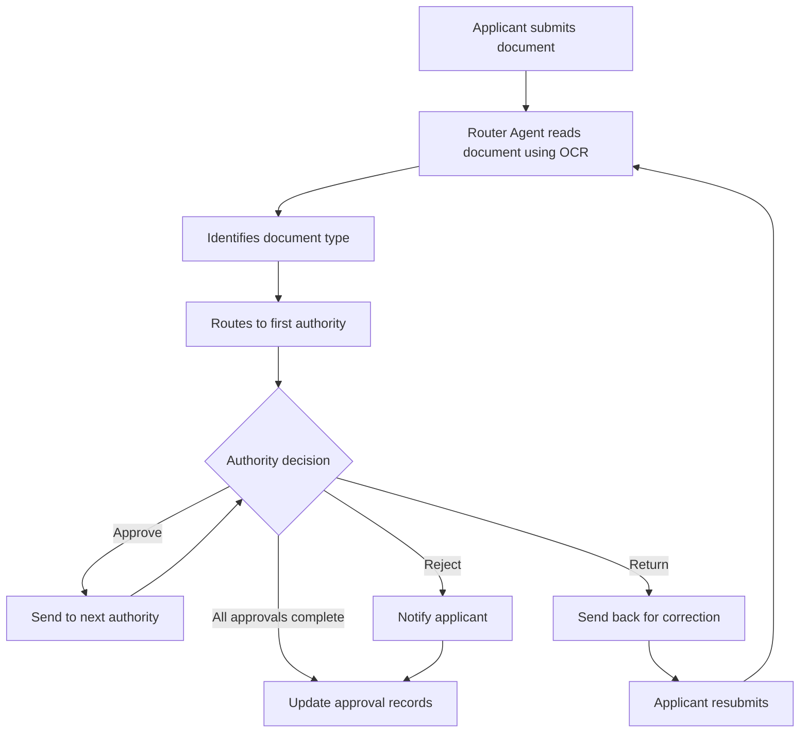
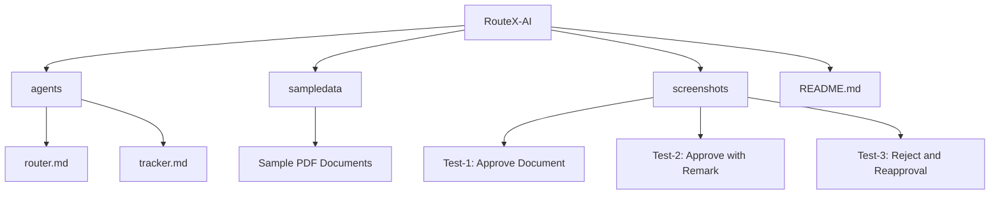

# RouteX-AI
### AI-Powered Document Approval Routing System

RouteX-AI is an AI-powered document approval routing system that automates document processing, classification, and multi-level approval workflows. It uses OCR to extract key information, routes documents to the appropriate authorities, and manages approval or rejection decisions along with remarks. It also tracks document status in real time and maintains structured approval records, ensuring a transparent, efficient, and well-organized workflow.

## Features

- **OCR-Based Extraction:** Extracts key information from submitted documents.
- **Document Classification:** Identifies document types and determines the appropriate approval workflow.
- **Automated Routing:** Routes documents to the relevant authorities in the correct sequence.
- **Approval & Rejection Management:** Handles approval, rejection, and return decisions with remarks.
- **Real-Time Tracking:** Keeps applicants informed about the current approval stage.
- **Approval Records:** Maintains structured records of final decisions and approval history.

## Workflow

1. Applicant submits a document in the Submissions room.
2. Router Agent uses OCR to extract relevant information.
3. The system identifies the document type and its predefined approval chain.
4. The document is sent to the first authority.
5. The authority approves, rejects, or returns the document with remarks.
6. Approved documents move to the next authority until the approval chain is complete.
7. Tracker Agent provides status updates and maintains the final approval record.

## Document Routing Diagram



## AI Agents

### 1. Router Agent

- Reads submitted documents using OCR.
- Extracts document name, type, applicant name, and date.
- Identifies the predefined approval chain.
- Routes documents to the appropriate authorities.
- Handles approval, rejection, and return decisions with remarks.
- Notifies applicants about document status and decisions.

### 2. Tracker Agent

- Tracks the current approval stage.
- Shows which authorities have approved the document.
- Responds to applicant status queries.
- Maintains final approval and rejection records.

## Approval Chain Configuration

| Document Type | Approval Sequence |
|---|---|
| Leave Application | Team Lead → HR Manager |
| Expense Reimbursement | Team Lead → Finance Manager |
| Purchase Request | Department Head → Finance Manager → COO |
| Salary Advance Request | HR Manager → Finance Manager → COO |

## Room Configuration

The system uses seven rooms for communication and workflow management.

| Room | Purpose |
|---|---|
| Submissions | Document submissions and applicant communication |
| Team Lead | Team Lead approvals |
| Department Head | Purchase request approvals |
| HR Manager | HR-related approvals |
| Finance Manager | Financial approvals |
| COO | Final-level approvals |
| Approval Records | Final approval and rejection records |

## Technology Used

- **Switch:** Platform for configuring AI agents, communication rooms, and workflows.
- **OCR (Optical Character Recognition):** Extracts text and key information from documents.
- **AI Agents:** Handle document routing and approval tracking.
- **Workflow Automation:** Manages multi-level approval processes and decision handling.

## How Switch Connects Agents and Users

Switch provides shared communication rooms where users and AI agents interact.

- **Rooms:** Common spaces for communication between applicants, authorities, and agents.
- **Router Agent:** Receives submissions and coordinates document movement between authority rooms.
- **Tracker Agent:** Provides status updates and maintains final approval records.
- **Users:** Submit documents and provide approval decisions or remarks.

For example, in the Team Lead room, the Router Agent shares a submitted document with the Team Lead. The Team Lead replies with a decision, and the Router Agent processes the response and moves the document to the next step when approved.

## Project Structure

```text
RouteX-AI/
│
├── agents/
│   ├── router.md
│   └── tracker.md
│
├── sampledata/
│   ├── ExpenseReimbursement.pdf
│   ├── Purchaserequest.pdf
│   ├── Purchaserequest_revised.pdf
│   ├── Salaryadvancerequest.pdf
│   ├── sample_leave_application.pdf
│   └── unclear_sample_document.pdf
│
├── screenshots/
│   ├── Test-1 (Approve Document)/
│   ├── Test-2 (Approve+Remark)/
│   └── Test-3(Reject Document+Reapproval)/
│
└── README.md
```

## Project Structure Diagram



## Purpose

To simplify document approvals by reducing manual coordination, improving transparency, and providing structured tracking throughout the approval process.
