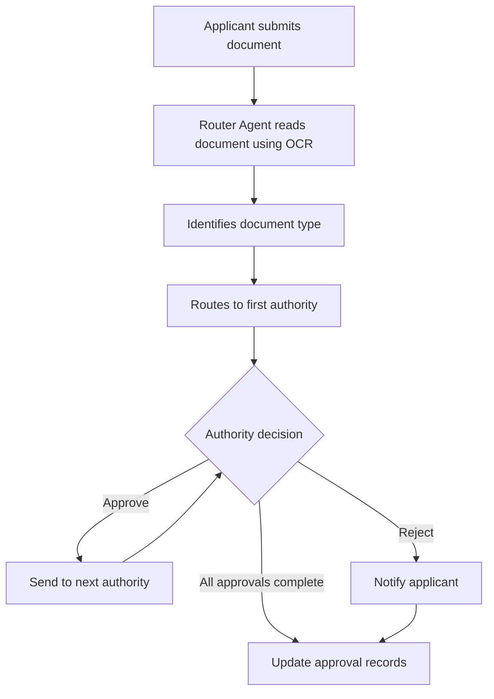

# RouteX-AI

### AI-powered document approval routing on Switch

**Upload a document. RouteX routes it, authorities approve it, and every step is recorded.**

Built for the **Flip the Switch Hackathon** (WeMakeDevs x DevTools Academy x Switch), **Track 1: Best Business Workflow**.

**Demo video:** [Watch the demo](ADD-LINK-HERE)

Built by Aditi.


*The router and tracker agents and the seven rooms, set up in Switch.*

---

## What it does

In most companies, a document such as a leave request or an expense claim passes through several authorities, and each document type has its own approval order. It is hard to tell where a document is, who has approved it, or why it was rejected.

RouteX-AI runs this process inside team chat using Switch. An applicant uploads a document, a **router agent** reads it with OCR, identifies the document type and sends it through the right authorities in order, and a **tracker agent** answers status questions and keeps the final approval record.

## Workflow

1. The applicant uploads a document in the **Submissions** room.
2. The router agent reads it with OCR and extracts the document name, type, applicant name and date.
3. The router looks up the approval chain for that document type and posts the document in the first authority's room.
4. The authority replies `@router approve` or `@router reject <remarks>`.
5. On approval, the router moves the document to the next authority until the chain is complete. On rejection, it tells the applicant with the remarks.
6. The tracker agent answers "where is my document?" and posts one entry per finished document in **Approval Records**.
7. If the router cannot read a file or match its type, it asks the applicant instead of guessing.



## AI agents

| Agent | What it does |
|---|---|
| **Router** | Reads uploads with OCR, extracts name, type, applicant and date, picks the approval chain, routes the document to each authority, handles approve and reject decisions with remarks, and notifies the applicant |
| **Tracker** | Tracks the current approval stage, shows who has approved so far, answers status questions, and writes the final approval or rejection record |

The exact instructions for both agents are in the [`agents/`](agents/) folder.

## Approval chains

| Document type | Approval sequence |
|---|---|
| Leave application | Team Lead → HR Manager |
| Expense reimbursement | Team Lead → Finance Manager |
| Purchase request | Department Head → Finance Manager → COO |
| Salary advance request | HR Manager → Finance Manager → COO |

## Rooms

| Room | Members | Purpose |
|---|---|---|
| Submissions | applicants, router | Document submissions and applicant communication |
| Team Lead | router, authority | Team Lead approvals |
| Department Head | router, authority | Purchase request approvals |
| HR Manager | router, authority | HR-related approvals |
| Finance Manager | router, authority | Financial approvals |
| COO | router, authority | Final-level approvals |
| Approval Records | tracker only | Final approval and rejection records |

## How Switch is used

Switch is central to the project, not an add-on:

- **Rooms are the workflow.** Each authority is a room, so a document "moving" means the router posts it in the next room.
- **Agents join rooms like teammates.** The router and tracker are Switch agents, and each sees only the rooms it belongs to.
- **Room membership is access control.** Only the tracker is in Approval Records, so the audit record has a single writer.
- **People and agents share one history.** Applicants, authorities and agents work in the same chat, and the full trail stays in one place.

Without Switch there would be no shared rooms, no agent membership and no per-room routing.

## Built with

Switch, Switch Console, opencode (agent engine), Mattermost (team chat), Docker, OCR through the agent.

## How to run

1. Install Docker and Switch Console, and start the local Switch server. See the [Switch getting-started guide](https://docs.switchagents.ai/switch-rooms/getting-started).
2. Open the **my-buddy** chat in Switch Console.
3. Send my-buddy the setup message below. It shows its plan first, so review it and reply to confirm.
4. Upload a file from [`sampledata/`](sampledata/) in **Submissions**, and mention `@router` in the same message.
5. In each authority room, reply `@router approve` or `@router reject <remarks>`.
6. Check **Approval Records** for the final entry.

<details>
<summary>Setup message for my-buddy</summary>

```
I want to build a document approval routing system. Please set it up in Switch.

1. Create two agents:

- "router": When an applicant uploads a document file in the "Submissions" room, the router first reads the document using OCR and extracts:
  - document type
  - applicant name
  - date
Then it looks up the approval chain for that document type (listed in section 3) and posts the document in the first authority's room, stating the document name, type and current step.
When an authority replies "approve", the router moves the document to the next authority in that document's chain.
If the reply is "reject" or "return", the router tells the applicant in "Submissions" with the remarks.
If the router cannot read the file, or the type is not in the list, it asks the applicant to reply with the correct type. Do not guess.
The router must always state the document name, type and current step.

- "tracker": Answers "where is my document?" with the current step and who has signed so far. When a document is fully approved or rejected, post ONE entry in "Approval Records" in exactly this format:
Document: <name and type>
Applicant: <name>
Path: <authorities in order>
Decision: <approved or rejected>
Remarks: <any remarks>
Date: <date>
Post nothing else in that room.

2. Authorities:
- Team Lead
- Department Head
- HR Manager
- Finance Manager
- COO

3. Approval chains by document type (each document type has its own order, using only the authorities above):
- Leave application: Team Lead, then HR Manager
- Expense reimbursement: Team Lead, then Finance Manager
- Purchase request: Department Head, then Finance Manager, then COO
- Salary advance request: HR Manager, then Finance Manager, then COO

4. Create these rooms:
- "Submissions": applicants and the router.
- "Team Lead", "Department Head", "HR Manager", "Finance Manager" and "COO": the router and me.
- "Approval Records": the tracker only.

Do NOT create any other agents or rooms.
Show me the changes before applying them.
```

</details>

## Tested

- **Test 1:** document approved through the full chain.
- **Test 2:** approval with a remark.
- **Test 3:** document rejected, then reapproved after resubmission.

Screenshots are in the [`screenshots/`](screenshots/) folder.

## Limitations

- Approval is a chat approval and an audit record, not a legal signature.
- OCR works best on typed PDFs and clear images. For unclear documents, the router asks the applicant for the type instead of guessing.
- The agents follow written instructions, so routing state is kept in the room history and not in a separate database.
- The router acts only on messages addressed to it, so use `@router approve`.
- Tested with a small set of sample documents, not at scale.

## Future work

- A custom router agent built on the Switch agent protocol, with chains and statuses stored in a database.
- Stamping approvals onto the PDF.
- Reminders when a document waits too long with one authority.

## Project structure

```text
RouteX-AI/
├── agents/
│   ├── router.md
│   └── tracker.md
├── sampledata/
│   ├── ExpenseReimbursement.pdf
│   ├── Purchaserequest.pdf
│   ├── Purchaserequest_revised.pdf
│   ├── Salaryadvancerequest.pdf
│   ├── sample_leave_application.pdf
│   └── unclear_sample_document.pdf
├── screenshots/
│   ├── Test-1 (Approve Document)/
│   ├── Test-2 (Approve+Remark)/
│   └── Test-3(Reject Document+Reapproval)/
└── README.md
```
